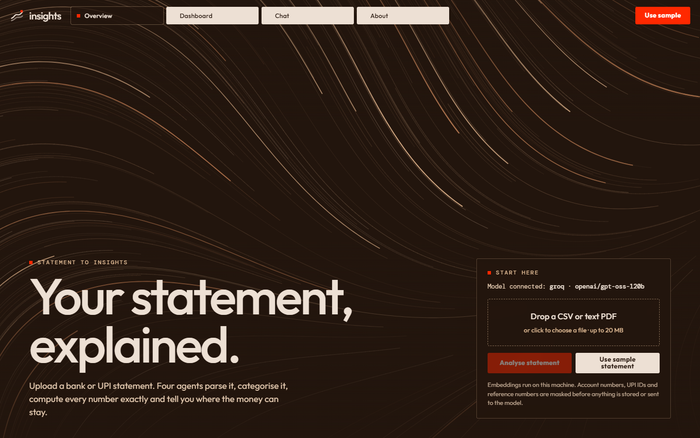
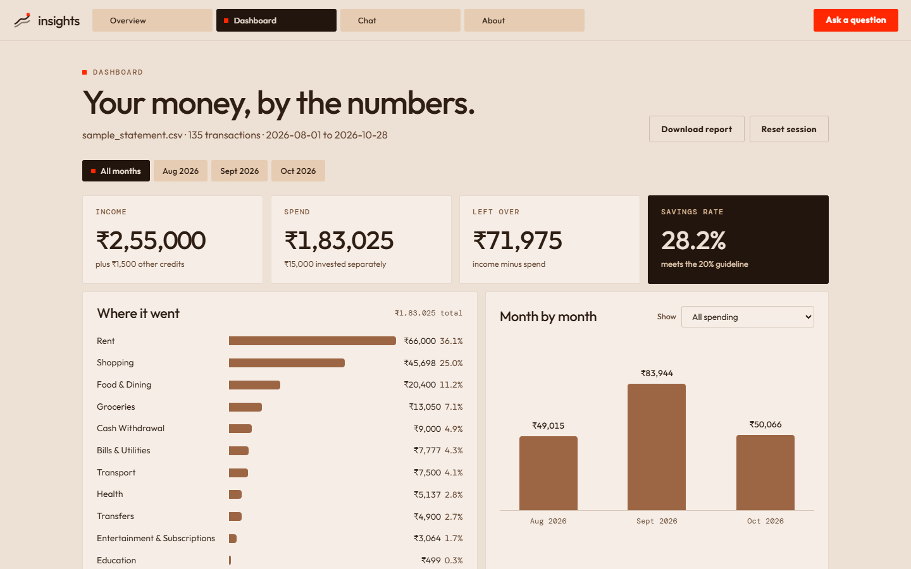
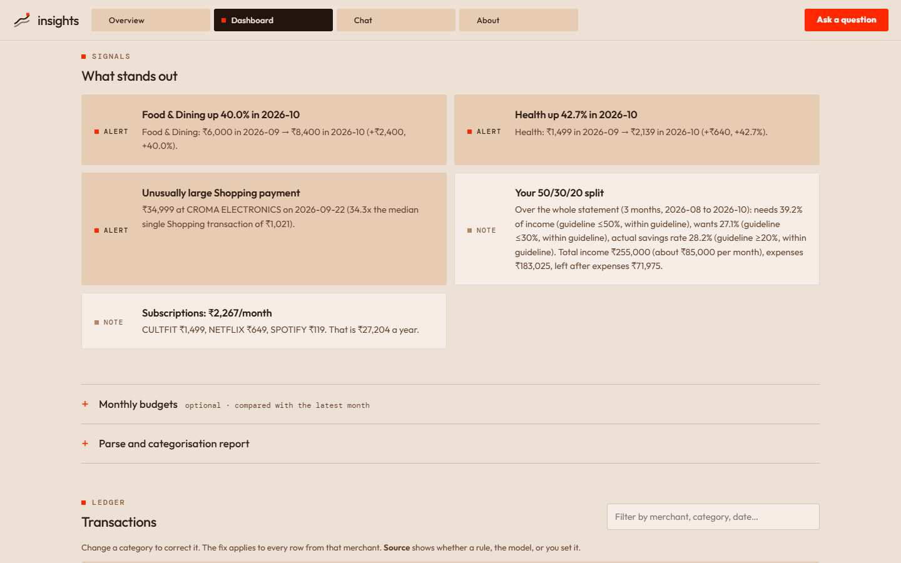
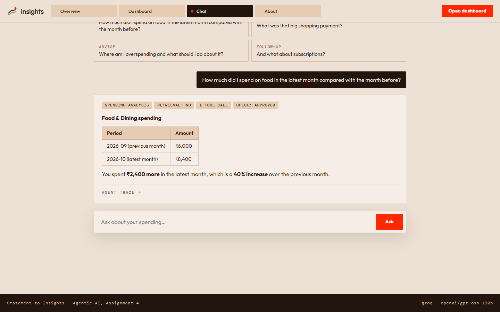
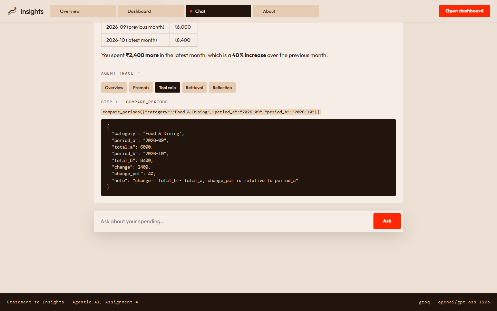
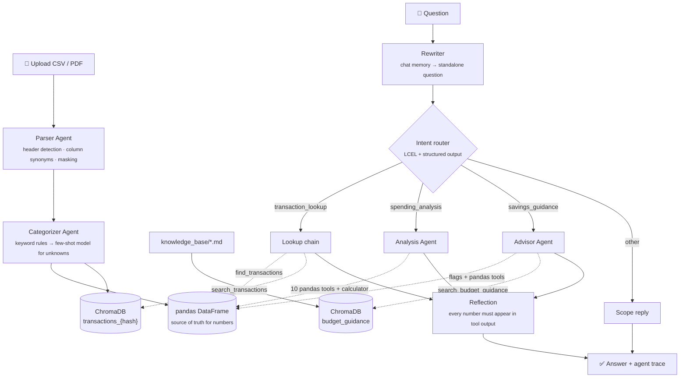

<div align="center">

# Statement-to-Insights

**Upload a bank or UPI statement. Chat with it. Get exact numbers and grounded advice.**

Four AI agents parse your statement, categorise every transaction, compute figures with real tools
(never by guessing) and suggest where you can save, citing a budgeting knowledge base.


*Agentic AI · Assignment 4*



</div>

---

## Contents

- [Highlights](#highlights)
- [Quick start](#quick-start)
- [Demo data](#demo-data)
- [Five-minute demo script](#five-minute-demo-script)
- [Screenshots](#screenshots)
- [How it works](#how-it-works)
- [Assignment criteria](#assignment-criteria)
- [Prompt catalogue](#prompt-catalogue)
- [Configuration](#configuration)
- [Project layout](#project-layout)
- [Testing](#testing)
- [Privacy and safety](#privacy-and-safety)
- [Troubleshooting](#troubleshooting)

---

## Highlights

| | |
|---|---|
| 🧮 **The model never does arithmetic** | Every total, share and comparison comes from a pandas tool or a safe calculator. The model only chooses the tool and explains the result. |
| ✅ **Every answer is fact-checked** | A reflection step checks that each number in the answer appears in the tool outputs. Unsupported figures are removed, or flagged to you as *not verified*. |
| 🔎 **Retrieval is a decision** | Search is exposed as tools. The agent searches only when a question needs it, and the trace shows *Retrieval used: yes / no*. |
| 🧭 **Fully traceable** | Under every answer: detected intent, the rewritten question, every system and user prompt, each tool call with its result, retrieved chunks, and the fact-check verdict. |
| 🔒 **Private by design** | Embeddings run on your machine. Account numbers, card numbers, UPI IDs and reference numbers are masked before anything is stored or sent to a model. |
| 🔁 **Bring your own model** | Groq, Google Gemini or Ollama, switchable per session from the Overview page. |

### The four agents

| Agent | Job | How |
|---|---|---|
| **Parser** | Turns any CSV or text PDF into one clean table | Finds the table under the bank's banner lines, maps columns with a synonym table (the model is the fallback), handles Indian number formats and `Dr`/`Cr`, masks identifiers |
| **Categorizer** | Puts every transaction in one of 14 categories | Keyword rules first; only merchants the rules can't place go to the model, in one batch with few-shot examples |
| **Analysis** | Answers "how much / compare / trend" questions | ReAct tool loop over 10 exact pandas tools plus a calculator |
| **Advisor** | Answers "where am I overspending / how do I save" | Deterministic overspending flags, budgeting notes it retrieves and cites, then a fact check |

---

## Quick start

> Requires **Python 3.10+** (developed on 3.12) and one free LLM API key (Groq or Google).

```bash
# 1. Install
python -m venv .venv
.venv\Scripts\activate                 # macOS/Linux: source .venv/bin/activate
pip install -r requirements.txt

# 2. Configure
copy .env.example .env                 # macOS/Linux: cp .env.example .env
#    then put your key in .env, e.g. GROQ_API_KEY=...

# 3. Build the budgeting knowledge base once (also downloads the ~90 MB embedding model)
python -m rag.build_kb

# 4. Run
python server.py
```

Open **http://localhost:8000** and click **Use sample statement**.

> [!TIP]
> No API key yet? The Dashboard still works: categories come from the rules, and every chart and alert is computed
> without a model. Only the Chat needs an LLM.

---

## Demo data

Two synthetic statements are included. Neither contains real data. Both have patterns planted on purpose, so every demo question has a known answer.

<table>
<tr><th width="50%"><code>data/demo_statement.csv</code> · small</th><th width="50%"><code>data/sample_statement.csv</code> · full</th></tr>
<tr valign="top"><td>

33 transactions · Sep–Oct 2026 · simple columns<br>
Drag it onto the Overview page.

| Ask | Answer |
|---|---|
| Food, Oct vs Sep? | ₹1,770 → ₹3,220 (**+81.9%**) |
| Big shopping payment? | Croma **₹24,999** on 17 Oct |
| Subscriptions? | Netflix + Spotify = **₹768/mo** |
| Savings rate? | **32.9%** |

</td><td>

135 transactions · Aug–Oct 2026 · real bank export layout<br>
Click **Use sample statement**.

| Ask | Answer |
|---|---|
| Food, latest vs previous month? | ₹6,000 → ₹8,400 (**+40%**) |
| Big shopping payment? | Croma **₹34,999** on 22 Sep |
| Subscriptions? | Netflix, Spotify, Cult.fit = **₹2,267/mo** |
| Savings rate? | **28.2%** |

</td></tr>
</table>

Both include merchants the rules don't know (Chaayos, and people such as Priya Sharma), so you can show the model categorising them.
Regenerate the full sample with `python data/generate_sample.py`.

---

## Five-minute demo script

| # | Do | Point out |
|---|---|---|
| 1 | Click **Use sample statement** | Dashboard tiles, category bars, monthly bars, alerts |
| 2 | Open **Parse and categorisation report** and the ledger | A `rule` row (SWIGGY) next to a `model` row (CHAAYOS, PRIYA SHARMA) |
| 3 | Ask *"How much did I spend on food in the latest month compared with the month before?"* | Intent `spending_analysis`, tool `compare_periods`, **retrieval: no** |
| 4 | Ask *"What was that big shopping payment?"* | Intent `transaction_lookup`, Croma ₹34,999 |
| 5 | Ask *"Where am I overspending and what should I do about it?"* | Intent `savings_guidance`, **retrieval: yes**, cited notes, fact-check verdict |
| 6 | Ask *"And what about subscriptions?"* | Memory: the rewriter turns the follow-up into a standalone question |
| 7 | Open `prompts/prompts.py` and `core/router.py` | The system/user prompts and the LCEL chain |

> [!NOTE]
> Free tiers are rate-limited. On Groq, leave a few seconds between questions.

---

## Screenshots

<table>
<tr>
<td width="50%"><br><sub><b>Dashboard</b>: exact totals, spend by category, month by month.</sub></td>
<td width="50%"><br><sub><b>Signals</b>: deterministic overspending flags, computed before any model runs.</sub></td>
</tr>
<tr>
<td width="50%"><br><sub><b>Chat</b>: each answer is tagged with intent, retrieval, tool calls and the fact-check result.</sub></td>
<td width="50%"><br><sub><b>Agent trace</b>: the exact tool call and the numbers it returned.</sub></td>
</tr>
</table>

---

## How it works



> [!IMPORTANT]
> **Semantic search finds *which* transactions are relevant; pandas computes *how much*.**
> Similarity search returns only the top few matches, so it is never used to compute a total.

<details>
<summary><b>The tools the agents can call</b></summary>

| Tool | Returns |
|---|---|
| `get_total_spend(category, start_date, end_date)` | Total debit amount and count |
| `category_breakdown(start_date, end_date)` | Amount and share per category |
| `monthly_trend(category)` | Month-by-month totals with % change |
| `top_merchants(n, category, start_date, end_date)` | Top merchants by spend |
| `compare_periods(period_a, period_b, category)` | Both totals, absolute and % change |
| `find_transactions(merchant, min_amount, max_amount, dates, category, txn_type, sort_by)` | Matching rows (exact filters) |
| `detect_recurring()` | Subscriptions and other recurring payments, monthly and yearly cost |
| `detect_anomalies()` | Transactions far above their category's median |
| `income_vs_expense(start_date, end_date)` | Income, expense, invested, net, savings rate |
| `calculator(expression)` | Safe arithmetic, parsed with `ast` (no `eval`) |
| `search_transactions(query, k, category, month)` | Semantic search over transactions |
| `search_budget_guidance(query, k)` | Semantic search over the budgeting notes |

</details>

<details>
<summary><b>Guardrails</b></summary>

- **Number check.** Every figure in an answer must match a tool output (allowing for rounding). If it doesn't, a critique prompt revises the answer once; anything still unverified is shown to you.
- **Citation check.** The Advisor's `(source: …)` citations are kept only for notes it actually retrieved.
- **Rewrite check.** If the rewriter adds a month or period you never mentioned, the rewrite is rejected and your own wording is used.
- **Flags first.** Overspending is computed in pandas before the model runs, and the Advisor may only call something "overspending" if a flag says so.
- **Five-step cap** on every tool loop, and a 60-second timeout on every model request.
- **Keyword fallback** for the router, so a malformed model reply never crashes the app.

</details>

---

## Assignment criteria

| # | Criterion | Where it is | How to show it |
|:-:|---|---|---|
| 1 | **LLM integration** | `config.get_llm()`, used by every agent | Overview page shows provider and model; any chat answer |
| 2 | **Interactive GUI** | `web/` (HTML/CSS/JS) served by `server.py` | Upload, charts, editable ledger, budgets, chat with suggested questions |
| 3 | **Prompt engineering** | `prompts/prompts.py`: zero-shot, few-shot, chain of thought, ReAct, reflection | Trace → **Prompts** shows the system and user prompt of every call; **Reflection** shows the verdict |
| 4 | **LangChain core components** | `ChatPromptTemplate`, `MessagesPlaceholder`, LCEL pipes, `RunnablePassthrough.assign`, `RunnableBranch`, `with_structured_output`, `bind_tools`, `@tool`, `StrOutputParser` | `core/router.py` → `build_pipeline()` |
| 5 | **Agentic RAG** | `tools/retrieval_tools.py`: retrieval as tools the agent chooses to call | Ask one question that retrieves and one that doesn't; compare *Retrieval used* |
| 6 | **Intent detection and routing** | `core/router.py`: Pydantic `Intent`, router chain, `RunnableBranch` | Trace → **Overview** shows intent, reason and handler |
| 7 | **Vector database** | ChromaDB `transactions_<hash>` and `budget_guidance` (`rag/vectorstore.py`) | Trace → **Retrieval** shows collection, query, chunks and similarity |

---

## Prompt catalogue

Every prompt lives in [`prompts/prompts.py`](prompts/prompts.py) as a named `ChatPromptTemplate` with a separate **system** and **user** message.

| Prompt | Technique | Used by |
|---|---|---|
| `PARSER_PROMPT` | Zero-shot, strict schema | Parser, only when column synonyms fail |
| `CATEGORIZER_PROMPT` | Few-shot (9 labelled examples) | Categorizer, unknown merchants in batches of 25 |
| `REWRITER_PROMPT` | Zero-shot with chat history | Follow-up questions |
| `ROUTER_PROMPT` | Few-shot, structured output | Intent router |
| `ANALYSIS_PROMPT` | Chain of thought + ReAct | Analysis Agent |
| `LOOKUP_PROMPT` | ReAct + agentic retrieval | Lookup chain |
| `ADVISOR_PROMPT` | Retrieval-grounded generation + ReAct | Advisor Agent |
| `REFLECTION_PROMPT` | Reflection / self-critique | Answers that fail the number check |
| `SCOPE_PROMPT` | Zero-shot | Greetings and off-topic questions |

---

## Configuration

All settings live in `.env` (copy it from [`.env.example`](.env.example)).

| Variable | Purpose | Example |
|---|---|---|
| `LLM_PROVIDER` | Default provider: `groq`, `google` or `ollama` | `groq` |
| `LLM_MODEL` | Model for the default provider | `openai/gpt-oss-120b` |
| `GROQ_API_KEY` / `GOOGLE_API_KEY` | API keys (both have free tiers) | |
| `GOOGLE_MODEL` | Model used when you switch to Google | `gemini-3.5-flash-lite` |
| `OLLAMA_API_KEY` | Full Ollama cloud key (`<id>.<secret>`); leave empty for a local Ollama | |
| `OLLAMA_MODEL` | Model used when you switch to Ollama | `gpt-oss:120b` |
| `LLM_REASONING_EFFORT` | Reasoning effort for gpt-oss / qwen models | `low` |
| `LLM_TIMEOUT_SECONDS` | Give up on a model request after this long | `60` |

**Tested providers (November 2026)**

| Provider | Model | Status |
|---|---|---|
| Groq | `openai/gpt-oss-120b` | ✅ Default. Router and categoriser tests pass. Free tier: about 8,000 tokens/minute |
| Google | `gemini-3.5-flash-lite` | ✅ Router and categoriser tests pass |
| Ollama cloud | `gpt-oss:120b` | Needs usage credits on the Ollama account |

> [!NOTE]
> Model names change often. If a model is retired, list the provider's current models and update `.env`; no code changes are needed.

---

## Project layout

```text
├── server.py                FastAPI backend: JSON API over the agents, serves web/
├── web/                     Frontend: index.html, styles.css, app.js (no framework, no build step)
├── config.py                get_llm(), get_embeddings(), categories, thresholds
├── agents/                  parser, categorizer, analysis (+ lookup), advisor
├── core/                    router (LCEL), rewriter, tool_loop (ReAct), reflection, memory, assistant
├── tools/                   pandas_tools (10 tools), calculator, retrieval_tools (agentic RAG)
├── rag/                     vectorstore (Chroma collections), build_kb
├── prompts/prompts.py       every system and user prompt
├── knowledge_base/          10 original budgeting notes
├── data/                    generate_sample.py, sample_statement.csv, demo_statement.csv
├── tests/                   pytest suite + router_eval.csv (30 labelled questions)
├── docs/screenshots/        images used in this README
└── streamlit_app.py         earlier Streamlit UI, kept as a fallback
```

<details>
<summary><b>API endpoints</b></summary>

| Method | Path | Purpose |
|---|---|---|
| `GET` | `/api/state` | Model status, loaded statement, chat history |
| `POST` | `/api/llm` | Switch provider or model for this session |
| `POST` | `/api/statement/sample` | Load the bundled sample |
| `POST` | `/api/statement/upload` | Upload a CSV or PDF (optional password) |
| `GET` | `/api/dashboard?period=YYYY-MM` | Tiles, breakdown, trend, alerts |
| `GET` | `/api/transactions` | The ledger |
| `POST` | `/api/category` | Correct a merchant's category |
| `POST` | `/api/budgets` | Set monthly budgets |
| `POST` | `/api/chat` | Ask a question; returns the answer and its trace |
| `GET` | `/api/report` | Download a Markdown insights report |
| `POST` | `/api/reset` | Clear the session and its vector collection |

</details>

---

## Testing

```bash
pytest                 # 109 tests
pytest -m "not llm"    # 107 offline tests, no network needed
```

| Area | What is checked |
|---|---|
| Parser | Banner lines, separate or signed amount columns, `Dr`/`Cr`, Indian formats, masking, bad rows |
| Tools | Every tool against the planted golden numbers; calculator rejects unsafe input |
| Categorizer | Rules-only accuracy ≥ 85%; model accuracy ≥ 90% *(live)* |
| Router | Keyword fallback ≥ 20/30; model ≥ 27/30 on `router_eval.csv` *(live)* |
| RAG | Fuzzy queries find the right transactions and notes; no duplicate vectors on reload |
| Pipeline | Full LCEL chain with a scripted fake model: routing, rewriting, reflection revising a made-up number |
| API | Every endpoint, session isolation, upload validation |

Tests marked `llm` run when `.env` has a working model and are skipped otherwise. To test another provider:

```powershell
$env:LLM_PROVIDER = "google"; pytest -m llm      # PowerShell  (bash: LLM_PROVIDER=google pytest -m llm)
```

---

## Privacy and safety

- 🖥️ **Local embeddings.** Statement text is never sent out for embedding.
- 🕶️ **Masking.** Account numbers, card numbers, UPI IDs and reference numbers are masked before storage or any model call.
- 📤 **Minimal sharing.** The model sees merchant names when categorising and tool results when answering, never the full statement.
- 🧱 **No code execution.** Tools take typed arguments; the model never writes or runs pandas code. The calculator accepts only numbers and arithmetic.
- 🛡️ **Prompt-injection aware.** System prompts treat transaction descriptions as data and ignore any instructions in them. Model output is HTML-escaped before rendering.
- 🔑 **Secrets stay out of git.** `.env` and real statements (`*.pdf`, `uploads/`) are ignored; only synthetic data is in the repo.

> [!CAUTION]
> Advice from this app is general budgeting guidance, not professional financial advice.

---

## Troubleshooting

| Symptom | Cause and fix |
|---|---|
| *"model … does not exist"* or a 404 | The model was retired. List the provider's models and update `LLM_MODEL` / `GOOGLE_MODEL`. |
| Answers slow down after a few questions | Groq's free tier allows about 8,000 tokens per minute. Wait a few seconds, or switch provider. |
| *"daily free quota is used up"* | Google's free tier has per-model daily limits (`gemini-3.5-flash` allows only 20 requests a day). Use `gemini-3.5-flash-lite`. |
| *"needs credits or a paid plan"* | The Ollama cloud account has no credits. Add credits at ollama.com, or use a local Ollama. |
| *"rejected the API key"* | Check the key in `.env`. Ollama keys have two parts: `<id>.<secret>`. |
| First upload takes ~30 s | The embedding model loads on first use. Run `python -m rag.build_kb` before the demo. |
| Chat says it needs an LLM | No working key in `.env`. The Dashboard still works without one. |

<div align="center">
<br>
<sub>Built with LangChain, ChromaDB, FastAPI and plain HTML/CSS/JS.</sub>
</div>
